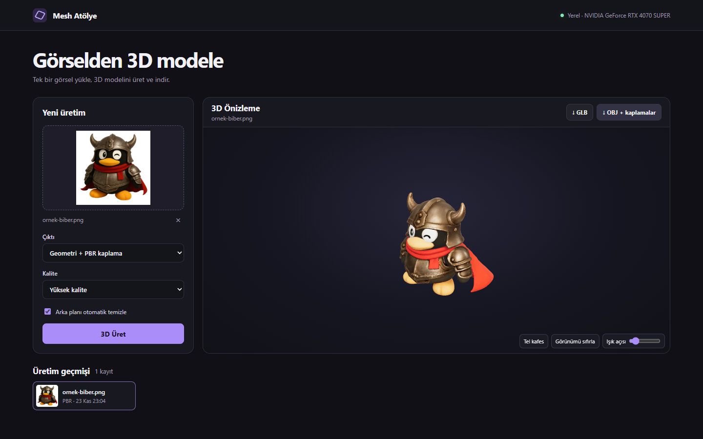

# Mesh Atölye

Mesh Atölye, tek bir nesne görselinden veya ön–yan–arka karakter paftasından 3B modeller üreten yerel bir Windows uygulamasıdır. Tarayıcıda modeli inceleyebilir, kaplamasını kaynak görselle iyileştirebilir ve GLB ya da OBJ olarak dışa aktarabilirsiniz.

Zırhlı penguen önizlemesi, Tencent Hunyuan3D örnek görseliyle yapılan ilk PBR denemesinden alınmıştır.

## Özellikler

- Tek görsel veya ön–yan–arka karakter paftasından geometri üretimi ve PBR kaplama.
- Döndürülebilen 3B önizleme, tel kafes, ayarlanabilir ışık ve hazır kamera açıları.
- Kaynak dokularla kaplama iyileştirme, üretim geçmişi ve önceki kaplamaya dönme.
- Birden çok geometri adayını değerlendiren, daha uzun örnekleme süreli Stüdyo profili.
- Kurulumdan sonra çevrimdışı üretim. Görseller ve çıktılar yerel olarak saklanır.

## Windows kurulumu

1. Depoyu klonlayın veya GitHub'da **Code → Download ZIP** ile indirip çıkarın.
2. **kurulum.bat** dosyasını çalıştırın. İlk kurulum için internet bağlantısı, CUDA uyumlu NVIDIA GPU ve en az 40 GB boş disk alanı gerekir. Betik Python, PyTorch, rasterizer paketleri, Three.js ve ağırlıkları proje dizinine kurar.
3. **baslat.bat** dosyasını açın. Arayüz varsayılan olarak [127.0.0.1:8173](http://127.0.0.1:8173/) adresinde çalışır.
4. Görselinizi yükleyin, kalite profilini seçin ve **3D Üret** düğmesine basın.

Yalnızca geometri için `kurulum.bat -Geometri`, başka bir yerel port için `baslat.bat --port 8174` kullanabilirsiniz.

## Doğrulanmış Stüdyo örneği

Çok görünüşlü ayrı bir Stüdyo testinde bir karakter, RTX 4070 SUPER üzerinde **8 dakika 9 saniyede** üretildi. Üç geometri adayı değerlendirildi. Kaplama görünümleri 768 piksel çözünürlükte 28 adımda üretildi. Kaplama aşamasında PyTorch'un ayırdığı tepe bellek yaklaşık 9,5 GiB olarak ölçüldü. Süre ve bellek kullanımı girdiye ve GPU'daki diğer yüklere göre değişir.

## Bir karakterin üç görünüşü

Ön, yan ve arka görünüşleri bu sırayla, aralarında boşluk olacak şekilde aynı yatay paftaya koyun. **Otomatik algıla**, üç ayrı ve benzer boyda siluet bulduğunda görünüşleri kırpar. **Ön, yan ve arka pafta** seçeneği ayrımı zorunlu kılar. Bir sahnedeki birden fazla nesneyi birlikte modellemek için **Tek görünüş** seçin. Orta profilde yüzün görselde baktığı yönü seçin. Varsayılan yön sağdır.

Pafta ayrımı arka plan maskesi çıkarır. Ayrılan referanslar önizlemenin altında görünür. Hunyuan3D-2mv üçünü geometri için birlikte kullanır. Hunyuan3D Paint 2.1 renk ve malzeme üretirken ön görünüşü referans alır. Önceden yüklenen bir paftayı yeniden işlemek için geçmişten açıp **Görseli tekrar kullan** düğmesine basın.

## Kaynak ayrıntıları

PBR üretimindeki **Kaynak ayrıntıları** ayarı, görüntüdeki silueti 3D modelin görünüşüyle hizalar. Güvenle eşleşen ve kameradan görülen yüzeylere kaynak görüntünün renklerini aktarır. Paftada ön, yan ve arka görüntülerin her biri kullanılır. Diğer yüzeyleri ve PBR malzemelerini Hunyuan3D Paint tamamlar. Çıktının silueti ve derinliği AI geometrisine bağlıdır.

Geçmişte bir PBR işi açıp **Kaplamayı iyileştir** düğmesine bastığınızda aynı geometriyle yeni bir kayıt oluşturulur. **Önceki kaplamayı gör** düğmesi kaynak kaydı açar. Önizlemenin altındaki referanslara tıklayarak modeli ilgili açıdan inceleyebilirsiniz.

Yüz görünürlüğü ve kamera açısıyla ağırlıklandırılmış doku aktarımı, çok görüntülü doku üretimindeki bilinen yaklaşımlardan yararlanır. [MVS-Texturing](https://github.com/nmoehrle/mvs-texturing) · [Hunyuan3D Paint ComfyUI uygulaması](https://github.com/visualbruno/ComfyUI-Hunyuan3d-2-1)

## Stüdyo profili

**Stüdyo · daha yavaş** profili, hazırlanmış görselde kullanılabilir bir siluet olduğunda 35, 56 ve 56 adımlı üç geometri adayı üretir. Maskelerin 3D adayların ön, yan ve arka izdüşümleriyle örtüşmesini ölçer. Birden çok referans varsa en zayıf açıyı da hesaba katar. Siluet ölçülemiyorsa 56 adımlı tek aday üretir. Yüzey çıkarma çözünürlüğü normalde 512'dir.

PBR modunda Stüdyo, 768 piksel kaplama görünümlerini 28 örnekleme adımıyla üretir, dışa aktarılan ağda 220.000'e kadar üçgeni korur ve kaynak ayrıntılarını aktarır. CUDA belleği yetersizse daha küçük çalışma çözünürlükleriyle yeniden dener. Geometri adayları ve kaplama adımları çalışma sırasında gösterilir. Tamamlanınca önizleme başlığında toplam süre görünür. Aday değerlendirmesi, dış hatların referansla uyuşmasını ölçer. Yüzün derinliği ve görüntüde görülmeyen ayrıntılar modelin tahminine bağlıdır.

## Çıktılar

- **GLB** tek dosyadır. PBR modunda renk ve metaliklik/pürüzlülük dokuları dosyada gömülüdür.
- **OBJ** her iki modda da doğrudan indirilir. PBR modundaki **OBJ + Dokular** düğmesi OBJ, MTL ve doku dosyalarını ZIP olarak indirir. ZIP içindeki dosyaları aynı klasöre çıkarın. Metaliklik ve pürüzlülük desteği OBJ okuyucusuna bağlıdır.
- Tamamlanan işler, kaynak görseller ve üretim günlükleri `uretimler/` klasöründe saklanır. Uygulamayı yeniden açtığınızda geçmişten eski işleri önizleyebilir ve indirebilirsiniz.

## Donanım ve kalite

Kurulum RTX 4070 SUPER (12 GB), 32 GB RAM ve NVIDIA 621.01 sürücüsü için hazırlanmıştır. Sürücünün raporladığı CUDA 13.5 uyumluluk seviyesidir. Uygulama CUDA 12.8 ile derlenmiş PyTorch 2.7.1 kullanır. CUDA Toolkit ve sistem çapında Python kurulumu gerekmez.

Geometri ve PBR ayrı süreçlerde, aynı GPU üzerinde sırayla çalışır. FP16 ağırlıklar CPU ve GPU arasında taşınır. Kaplama aşamasında MMGP profil 5, VAE dilimleme ve döşeme, küçük Real-ESRGAN döşemeleri ve sınırlı UV çözünürlüğü kullanılır. CUDA bellek hatasında uygulama ilgili aşamayı daha küçük bellek bütçesiyle bir kez daha dener. Kullanılabilir VRAM, Windows ve açık uygulamaların GPU kullanımına bağlıdır.

Yüksek kalite daha uzun geometri örneklemesi ve daha yüksek yüzey çözünürlüğü kullanır. PBR için 2048 × 2048 PBR dokuları ve en fazla 150.000 üçgenle dışa aktarır. Bellek yetersiz kalırsa uygulama daha küçük dokularla yeniden dener. Şeffaf kaynaklarda mevcut alfa kanalı kullanılır.

## Yerel API

- `POST /generate` alanları `image` (PNG/JPEG/WebP), `mode` (`geometry` veya `pbr`), `quality` (`fast`, `quality`, `reference` veya `studio`), `remove_background` (boolean), `layout` (`auto`, `single` veya `turnaround`) ve `profile` (`right` veya `left`). Tarayıcı varsayılan olarak `auto` gönderir. API çağrısında `layout` alanı atlanırsa `single` kullanılır. Başarılı yüklemede HTTP 202 ile iş kimliği gelir.
- `POST /api/jobs/{id}/refine` tamamlanmış bir PBR işini kaynak dokularla yeniden kaplamak üzere kuyruğa ekler.
- `GET /api/jobs/{id}` iş durumunu, aşamayı ve ilerlemeyi döndürür. `GET /api/jobs` geçmişi listeler.
- `GET /api/jobs/{id}/download/glb`, `/download/obj` ve PBR için `/download/obj-zip` dosyaları sunar.
- `GET /api/jobs/{id}/log` model çalıştırma günlüğünü açar. Kurulum günlüğü `kurulum.log` dosyasındadır.

Hunyuan3D kodu ve ağırlıkları Tencent lisanslarına tabidir. Bu lisanslar kullanım ve dağıtım için bölgesel koşullar içerir. [Hunyuan3D 2.1 lisansı](https://huggingface.co/tencent/Hunyuan3D-2.1/blob/main/LICENSE) · [Hunyuan3D-2mv lisansı](https://huggingface.co/tencent/Hunyuan3D-2mv/blob/main/LICENSE)
